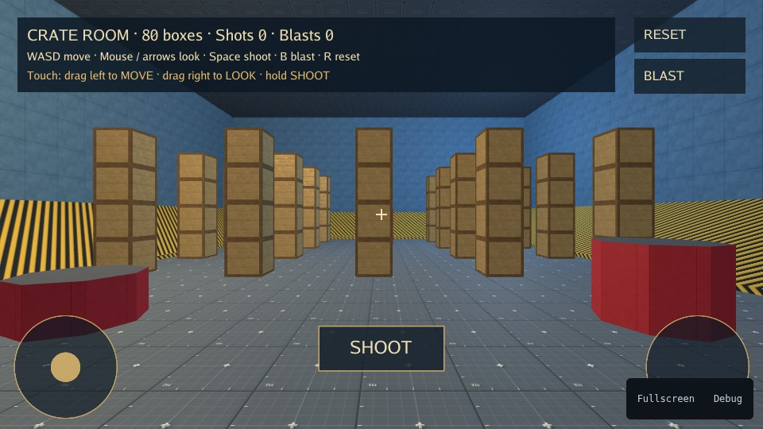

# 3D Controllers for Karty



_Crate Room, an existing Karty sample showing this view style. The sample's
artwork and gameplay are separate from this package._

Portable first-person walking/running, keyboard and mouse look, pitch limits,
mouse-capture requests and two independent touch sticks. Games own physics,
entities, collision policy and UI.

For a ready-to-play first-person camera, the generated SDK's
`Game.AttachFirstPerson` owns input, touch presentation, physics and cleanup.
It requires SDK 0.0.18 candidate and matching host artifacts, prepared locally
until published. Crate Room uses that built-in component; this package is for
applications that need to own their integration instead.

## Install

From your game directory:

```sh
karty package import /path/to/karty-packages/packages/controllers-3d
```

The package name is `controllers-3d`, version `0.0.1`. Its standalone Go module is
`github.com/karty-game/controllers-3d`; its Go package identifier remains `controllers`.
It requires Go 1.27 and has no external dependencies or generated SDK bindings.
To create a portable archive, run from the packages repository root:

```sh
mise run package -- controllers-3d
```

This produces `dist/releases/controllers-3d-0.0.1.kpkg` and its checksum.
The three controller packages release independently.

## Connect a first-person player

```go
import "github.com/karty-game/controllers-3d"

// During player setup:
player, err := controllers.NewFirstPerson(controllers.DefaultFirstPersonOptions())
// Handle err before using player.
```

1. Route keys through `Key`. In addition to movement and run controls, use
   `LookLeft`, `LookRight`, `LookUp` and `LookDown` for keyboard look.
2. Map pointer phases to `Pointer`. Pass `scene=true` only when a new gesture
   hits the game scene. Apply its `Capture`/`Release` requests to the host.
   `TouchStarted` can create a game-styled overlay using `Sticks`.
3. Call `Step(acceptedYaw, acceptedPitch)` once per update. Apply the returned
   yaw/pitch to the camera. Send `motion.X*60` and `motion.Y*60` to the host's
   horizontal velocity, including zeros when movement stops.
4. Stop the old body and release the host cursor on detach or view replacement.

Speeds use metres/second and radians/second; mouse sensitivity uses
radians/pixel. `Motion.X/Y` are per-update displacements, while `Motion.Z` is
an optional vertical action axis for game-owned swimming (`SwimUp`/`SwimDown`).
The host retains gravity. Start each step from the accepted camera heading so
blocked movement never accumulates.

`Pointer` supplies floating move/look sticks in the lower 55% of the logical
viewport. `Mouse` and the direct touch methods allow another gesture design.
Draw overlays with your own SDK entities or KartUI.

## Input and lifetime

Map your game's keys to `Forward`, `Backward`, `Left`, `Right`, and the `Alt`
controls for independent arrow-key aliases. Use `RunLeft` and `RunRight` for
the two Shift keys. Releasing one alias preserves another held key.
`BeginTouch`, `MoveTouch` and `EndTouch` support game-owned touch controls;
coordinates use logical viewport pixels. Route move/end/cancel to an owned
finger even when it leaves the scene. Hit-test UI before beginning a gesture.

Call `Reset` on focus loss, pause or player/view replacement. Start from the
default options, change the fields you need, then construct. `Configure`
validates transactionally and resets input; explicit zero speeds remain zero.
Keep one controller per player and do not copy it with active input. Calls run
once per fixed 60 Hz update, independently of rendering. Construction can
allocate; steady input and movement updates allocate no memory.

## Migration

This replaces the corresponding preset from the combined `controllers` package.
Import this package folder and change the Go import to the module above. Existing
constructor and method names for this preset are retained. Use import aliases if
a game needs multiple controller packages; their vector/option types are distinct.

Older combined archives and already-pinned games remain unchanged. See the
[split contract](../controllers-v2.md) for the package mapping.

## Validate

From the repository root, run `mise run test`, `mise run check-packages` and
`mise run build`. Each code package is tested through its own Go module.
