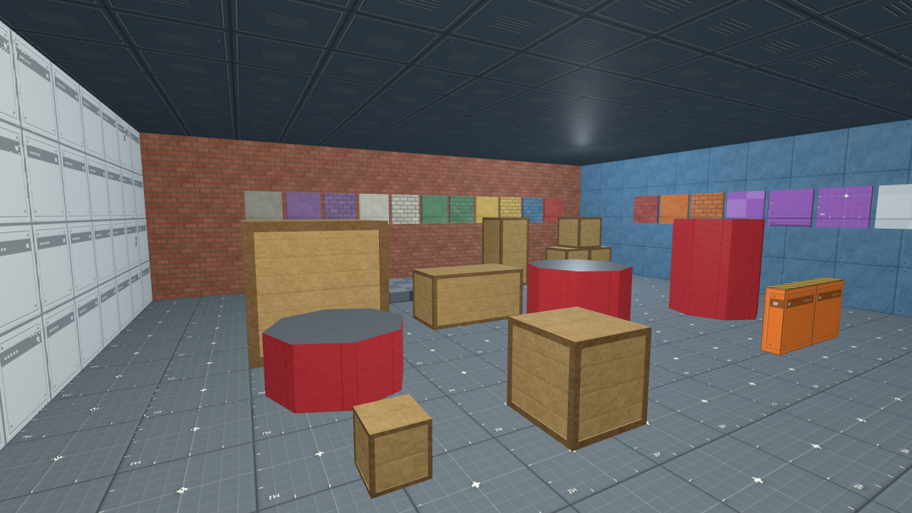
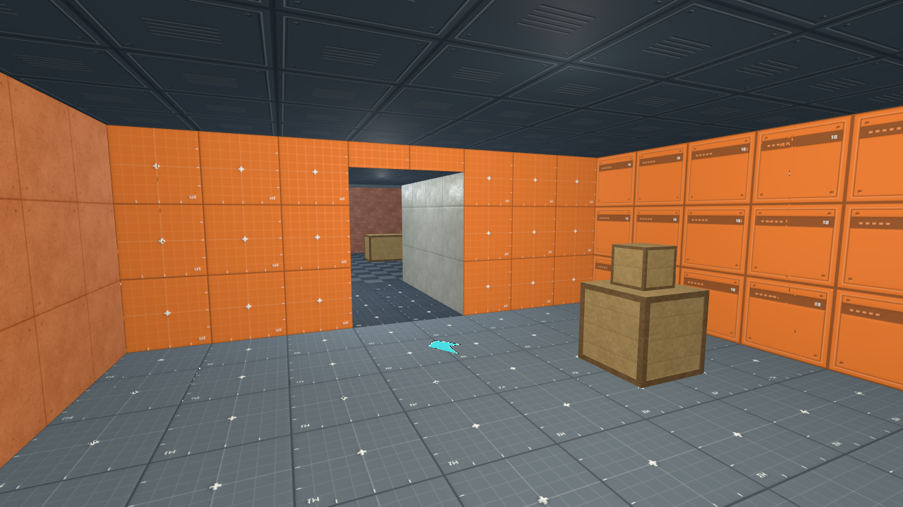
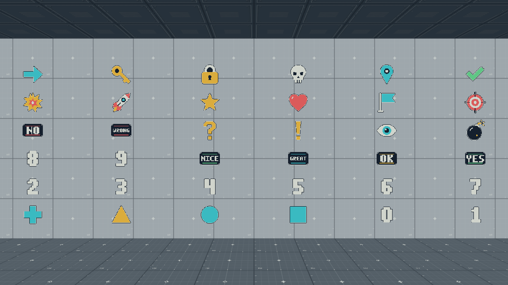
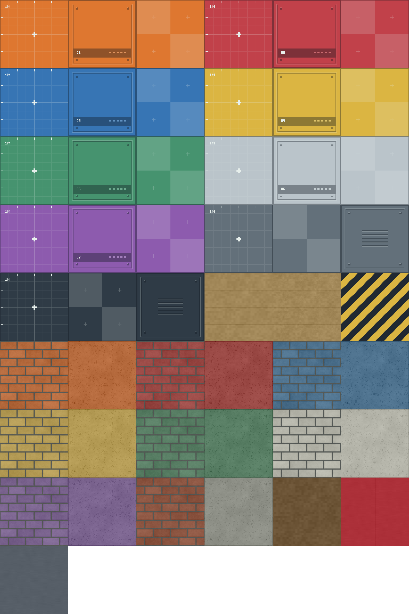
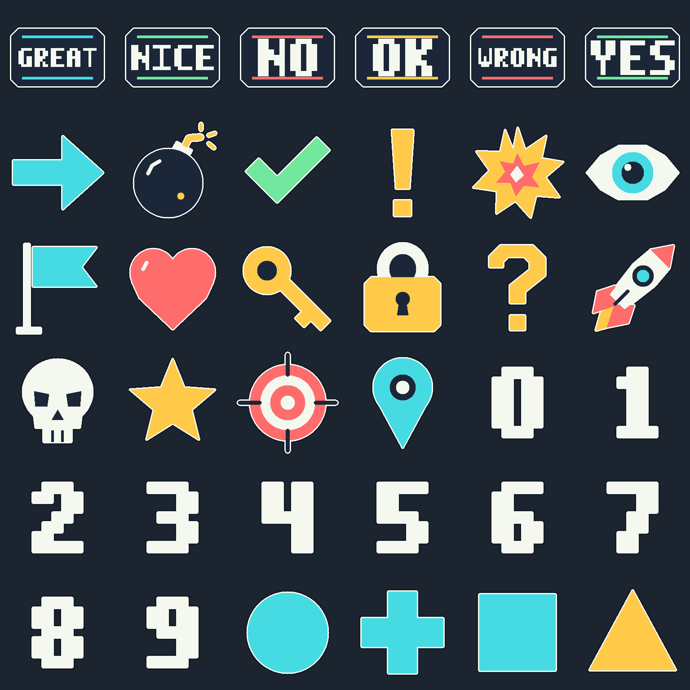

# FPS Placeholder Kit

Build a playable blockout in minutes: readable surfaces, pushable crates and
markers for the gameplay you have yet to build.



**256px textures · 49 materials · 36 transparent decals · 5 crate sizes · MIT**

|                   Two rooms and a corridor, ready to play                    |                Mark goals, routes and points of interest                |
| :--------------------------------------------------------------------------: | :---------------------------------------------------------------------: |
|  |  |
|               The FPS starter declares the kit automatically.                |            Shapes, digits, feedback and original pictograms.            |

## Start building

The FPS starter joins two eight-metre rooms with a four-metre corridor, two
metres wide. It includes static and dynamic crates, room numbers, a floor arrow
and a goal marker. Its `karty.toml` pins the kit’s versioned release archive
and SHA-256 checksum. The first restore downloads and verifies it; later
restores reuse the verified cache. Package docs appear at
`.karty/packages/fps-kit/README.md`.

**Release pending:** SDK 0.0.18 and the FPS Kit 0.1.0 release archive are not
published yet. The planned package repository is
[karty-game/karty-fps-kit](https://github.com/karty-game/karty-fps-kit); repository
creation and release publication are pending. The workflow below targets that
candidate; use the
[local archive setup](USAGE.md#local-candidate-setup) while preparing it locally:

```sh
karty new --sdk 0.0.18 --template fps --yes my-fps
cd my-fps
karty dev
```

For an existing game, import the package folder or an exported `.kpkg`:

```sh
karty package import /path/to/karty-cli/packages/fps-kit
```

Then use names such as `fps-kit.wall-blue-panel` or `fps-kit.floor-gray-grid` in
`world.yaml`. Imports select the assets you use automatically. No Go dependency
or asset-generation tools are needed to consume the package.

## Inside the kit

| Build with            | Included                                                                                                           |
| --------------------- | ------------------------------------------------------------------------------------------------------------------ |
| **Walls**             | Orange, red, blue, yellow, green, white and purple; grid, panel, checker, brick and concrete variants              |
| **Floors & ceilings** | Gray and dark grids, checks and panels; hazard trim                                                                |
| **Props**             | Small, medium, large, long and tall crates, each static or dynamic; a stack and low cover                          |
| **Bumpers**           | Red metal octagons, 1.7m across, with low (0.75m), cover (1.25m) and tall (2m) variants                            |
| **Decals**            | Four shapes, digits 0–9, six feedback words and 16 pictograms, including eyes, bombs, rockets, stars and waypoints |

All source textures are original **256×256 PNGs**. Karty’s ordinary Materialize
build generates normal, height and ambient-occlusion maps for world materials,
including brick and concrete. Decals have transparent backgrounds and use the
sprite pipeline. Red bumper sides and metal caps select the `metal` preset
automatically during the build.

Crate frames are geometry with seamless wood textures, keeping them aligned at
every size and rotation. The dynamic examples pair each crate with one matching
box collider.

## Try the galleries

Copy either example’s `level.toml` and `world.yaml` into an FPS starter’s
`levels/room/`, then run `karty dev`:

Remove the starter's `game.addCrates` call when switching rooms. For moving crates
in the material gallery, use the [gallery's spawn helper](examples/crates.go.tmpl)
and [setup instructions](USAGE.md#static-and-dynamic-crates).

- [Materials & props](examples/room): all 49 materials, every static crate size,
  three bumper heights and low cover. Author slopes directly in your level.

  [](examples/room)

- [Decals](examples/decals): the full set on a wall, plus floor placements.

  [](examples/decals)

[Usage & reference](USAGE.md) covers texture names, decal placement, crate physics,
UV scale, performance and regeneration. See the [validation record](VALIDATION.md)
for checks and capture details.

Original artwork and tracked generators, released under the [MIT license](LICENSE.md).
