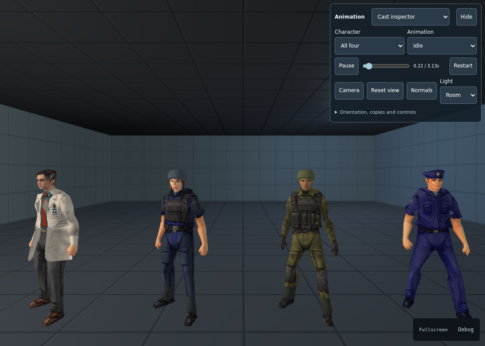

# FPS Low-poly Character

A retro FPS cast for your next game: a scientist, a female security guard,
an assault soldier and the original policeman.



**4 characters · 20 shared animations · Editable models · Go animation controller**

## Inside the package

- **Textured low-poly models** with a shared rig and editable Blender sources.
- **Movement and action clips:** idle, walk, run, crouch, crawl, jump, strafe,
  interaction, pistol actions, talking and three deaths.
- **One animation controller per actor**, driven by movement and action requests
  from player input or future NPC AI.

## Get started

Import the local package folder into a Karty project:

```sh
karty package import /path/to/karty-packages/packages/fps-lowpoly-character
```

Use the Go module `github.com/karty-game/fps-lowpoly-character` to select animation
from accepted movement after physics:

```go
var animation character.Controller // retain one per actor
pose := animation.Step(1.0/60, character.Input{
    Grounded: true,
    Forward: 1.4,
    Equipment: character.Pistol,
})
```

The package provides GLB assets and Go animation selection. Skinned-character
rendering still needs support in the released Karty SDK. See
[integration and known limits](INTEGRATION.md) for playback and asset details,
and [validation](VALIDATION.md) for the checks performed.

Code is MIT; artwork has separate source terms and publication clearance is
pending. See [credits and asset licenses](CREDITS.md).
